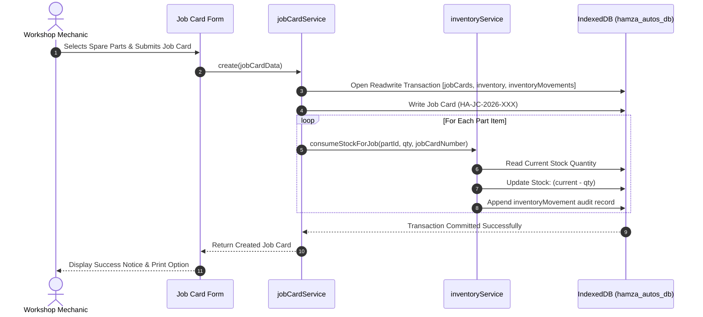

# Hamza Autos – Local-First Workshop Management System Architecture
**Location:** Abu Bakar Road, Badami Bagh, Lahore, Pakistan  
**Emergency & Workshop Contact:** +92 325 1814548  
**Architecture Paradigm:** Local-First Software (Client-Side Persistent IndexedDB)  
**Backend Dependencies:** 0 (Zero external servers, zero cloud databases, zero connection strings)

---

## 1. Architectural Philosophy & Core Principles

Hamza Autos operates in Badami Bagh, Lahore—one of the largest automotive and motorcycle parts markets in South Asia. In local Pakistani workshop environments, internet connectivity can be intermittent, power outages (load shedding) occur, and reliance on expensive cloud database subscriptions (e.g., hosted PostgreSQL, AWS RDS, MongoDB Atlas, or Firebase) introduces unnecessary operating costs and single points of failure.

To address these operational realities, Hamza Autos was engineered using a **Local-First Architecture**.

### Key Tenets
1. **Zero External Databases:** The application does not connect to MySQL, PostgreSQL, MongoDB, Firebase, Supabase, SQLite servers, or cloud APIs for storing data.
2. **Browser IndexedDB as Primary Storage:** The client's browser IndexedDB database (`hamza_autos_db`, Version 1) serves as the persistent system of record.
3. **Immediate Responsiveness:** All reads, writes, calculations, and updates happen instantly with sub-millisecond local latency.
4. **Offline Resilience:** The entire workshop suite—job cards, customer profiles, stock inventory, invoices, inspections, and booking management—remains fully functional without an active internet connection.
5. **Data Sovereignty & User Ownership:** Workshop data stays strictly inside the workshop device. Complete JSON exports allow seamless manual backups, offline archival, and migration across machines.

---

## 2. High-Level Architecture Diagram

```
+-----------------------------------------------------------------------------------+
|                                  HAMZA AUTOS UI LAYER                             |
|                                                                                   |
|  +--------------------+  +--------------------+  +-----------------------------+  |
|  | Customer Portal &  |  | Workshop Admin     |  | Public Website & Booking    |  |
|  | Bike Health Report |  | Operations Suite   |  | Multi-Step Flow             |  |
|  +---------+----------+  +---------+----------+  +--------------+--------------+  |
+------------|-----------------------|----------------------------|-----------------+
             |                       |                            |
+------------v-----------------------v----------------------------v-----------------+
|                               DOMAIN SERVICE LAYER                                |
|                                                                                   |
|  * customerService         * motorcycleService    * bookingService                |
|  * jobCardService          * inspectionService    * quotationService              |
|  * invoiceService          * paymentService       * inventoryService              |
|  * reminderService         * feedbackService      * whatsappService               |
|  * notificationService     * backupService        * storageService                |
+------------------------------------+----------------------------------------------+
                                     |
+------------------------------------v----------------------------------------------+
|                         INDEXEDDB STORAGE ENGINE (HAMZA_AUTOS_DB)                 |
|                                                                                   |
|   1. customers              2. motorcycles             3. bookings                |
|   4. jobCards               5. inspections             6. quotations              |
|   7. invoices               8. payments                9. inventory               |
|  10. inventoryMovements    11. maintenanceReminders   12. feedback                |
|  13. notifications         14. whatsappTemplates      15. applicationSettings     |
|  16. auditLogs                                                                    |
+-----------------------------------------------------------------------------------+
```

---

## 3. Storage Layer Design (`src/services/storageService.ts`)

### IndexedDB Initialisation & Lifecycle
- **Database Name:** `hamza_autos_db`
- **Schema Version:** `1`
- **Native Browser API:** Wrapped in lightweight asynchronous Promise abstractions with full transaction support.
- **Atomic Operations:** Multi-store transactions via `withTransaction(storeNames, mode, callback)` guarantee consistency during cross-entity updates (e.g., deducting inventory when creating a repair job card).

### 16 Persistent Object Stores
| Store Name | Primary Key (`keyPath`) | Primary Indexes | Purpose |
| :--- | :--- | :--- | :--- |
| `customers` | `id` | `phoneNumber`, `name`, `createdAt` | Customer CRM & contact directory |
| `motorcycles` | `id` | `customerId`, `registrationNumber`, `brand` | Registered bikes linked to customer profiles |
| `bookings` | `id` | `bookingNumber`, `customerPhone`, `appointmentDate`, `status` | Online service booking requests |
| `jobCards` | `id` | `jobCardNumber`, `customerPhone`, `repairStatus`, `assignedMechanic` | Workshop bay repair workflow tracker |
| `inspections` | `id` | `inspectionNumber`, `customerPhone`, `overallCondition` | 16-point motorcycle health diagnostic checklist |
| `quotations` | `id` | `quotationNumber`, `customerPhone`, `status` | Itemized PKR cost estimates before repair |
| `invoices` | `id` | `invoiceNumber`, `customerPhone`, `paymentStatus`, `jobCardId` | Official bills, receipts, and payment records |
| `payments` | `id` | `invoiceNumber`, `customerId`, `paymentDate`, `paymentMethod` | Cash, Bank, Easypaisa, and JazzCash payment logs |
| `inventory` | `id` | `partNumber`, `category`, `bikeModel`, `stockQuantity` | Spare parts catalogue with low-stock alerts |
| `inventoryMovements` | `id` | `partId`, `type`, `referenceId`, `timestamp` | Stock adjustment and consumption audit trail |
| `maintenanceReminders` | `id` | `customerPhone`, `dueDate`, `status`, `reminderType` | Preventative maintenance schedule alerts |
| `feedback` | `id` | `status`, `overallRating`, `submittedAt`, `isFeatured` | Customer review moderation pipeline |
| `notifications` | `id` | `type`, `isRead`, `createdAt` | In-app alerts for low stock and appointments |
| `whatsappTemplates` | `id` | `name` | Contextual WhatsApp message blueprints |
| `applicationSettings` | `id` | - | Workshop hours, contact information, SEO config |
| `auditLogs` | `id` | `action`, `performedBy`, `timestamp` | Internal administrative security log |

---

## 4. Domain Service Abstraction Layer

All read and write access to IndexedDB is routed through dedicated TypeScript services located in `src/services/`:

1. **`customerService`**: Manages customer registration, phone lookups, total visit tracking, and auto-creation from appointments or job cards (`findOrCreateFromActivity`).
2. **`motorcycleService`**: Links vehicles to customers by `customerId`, maintains odometer readings, engine displacements, and registration identifiers.
3. **`bookingService`**: Generates unique references (`HA-BK-2026-XXX`), enforces slot capacity (default: 2 bikes per 60-minute window), and prevents double-booking.
4. **`jobCardService`**: Tracks 10 discrete repair states (Received -> Diagnosis -> Parts Waiting -> Work In Progress -> Testing & Quality Check -> Ready for Delivery -> Delivered -> Cancelled -> Invoiced -> Closed). Executes automatic inventory deduction upon job creation and inventory restoration if cancelled.
5. **`inspectionService`**: Manages the 16-point mechanical & electrical inspection checklist, condition ratings (Good, Needs Attention, Requires Repair, Not Inspected, N/A), maintenance urgency, and WhatsApp sharing.
6. **`quotationService`**: Calculates subtotal, discounts, and tax in Pakistani Rupees (PKR), tracks quotation lifecycle (Draft -> Sent -> Approved -> Rejected -> Invoiced), and provides one-click invoice conversion.
7. **`invoiceService`**: Handles itemized billing (labour + parts), tracks partial and full payments, generates invoices (`HA-INV-2026-XXX`), and supports PDF/print workflows.
8. **`paymentService`**: Records transactions with payment method tagging (`Cash`, `Bank Transfer`, `Easypaisa`, `JazzCash`) and recalculates invoice balances.
9. **`inventoryService`**: Manages genuine spare parts (Honda Genuine, Yamaha Genuine, Crown-Lifan, NGK, etc.), calculates reorder points, and creates immutable `inventoryMovements`.
10. **`reminderService`**: Computes overdue, due today, and upcoming intervals for 10 preventative maintenance categories.
11. **`feedbackService`**: Implements a four-tier moderation workflow (`Pending`, `Approved`, `Rejected`, `Hidden`). Only `Approved` reviews display on public pages.
12. **`whatsappService`**: Formats contextual click-to-chat links using the official workshop WhatsApp (`+92 325 1814548`). Never sends autonomous spam; every message is user-confirmed.
13. **`backupService`**: Performs atomic exports of all 16 stores to a timestamped JSON file, validates backup schemas, provides record count previews, and offers dual restore modes (`Replace` with safety pre-backup vs `Merge`).

---

## 5. Transactional Integrity & Stock Synchronization



If any step fails or inventory is insufficient, the transaction rolls back cleanly without leaving orphan records.

---

## 6. Offline Capabilities & Quota Management

- **Storage Engine:** Standard W3C IndexedDB supported in all modern desktop and mobile browsers.
- **Estimated Storage Quota:** Desktop Chrome and Edge typically allocate between 10 GB and 100+ GB depending on available hard drive space. The complete Hamza Autos database with 10,000 job cards and photos requires less than 25 MB of storage.
- **Quota Inspection:** Admin can view real-time storage metrics (`usageMB`, `quotaMB`, `percentUsed`) directly inside the Backup & Restore module using `navigator.storage.estimate()`.

---

## 7. Security, Privacy & Integrity

1. **Zero External Data Leakage:** Customer phone numbers, vehicle registrations, and revenue figures are stored exclusively in the workshop operator's local browser storage.
2. **No Cloud Third Parties:** No trackers, telemetry, or remote databases intercept customer data.
3. **Admin Authentication:** Protected by local password hashing and session tokens.
4. **Client-Side WhatsApp Safety:** Messages are generated via URI encoding and opened in the official WhatsApp app or web client upon user click, preventing unauthorized bulk broadcasts.
