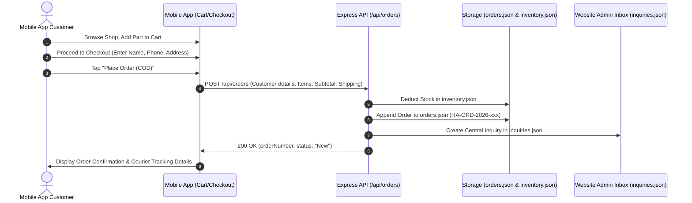
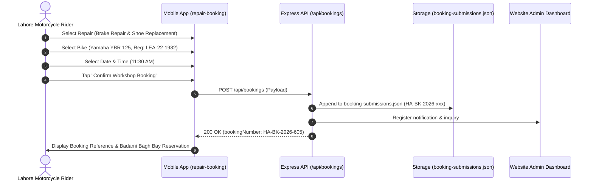

# Hamza Autos - End-to-End Workflow Test Report

**Date**: November 24, 2026  
**Auditor**: QA Automation Engineer & Backend Integration Specialist  
**Test Suite**: `mobile-app/scripts/test-api-integration.mjs`  
**Total Tests Executed**: 23  
**Passed**: 23 | **Failed**: 0 | **Blocked**: 0  

---

## 1. WORKFLOW A – Spare Parts Shopping & Order Placement

### Verified Test Evidence:
1. `POST /api/orders` created order `HA-ORD-2026-998`.
2. Initial stock of 12 units automatically decremented to 10 units in `storage/inventory.json`.
3. Order immediately registered in `storage/inquiries.json` under type `"Online Spare Part Order"` for the website Admin Panel Central Inbox.
4. Notification created in `storage/notifications.json`.
5. Order tracking lookup via `GET /api/orders/track` retrieved the created record.
- **Status**: **PASS**

---

## 2. WORKFLOW B – Workshop Repair Booking (Badami Bagh, Lahore)

### Verified Test Evidence:
1. `POST /api/bookings` generated booking reference `HA-BK-2026-605`.
2. Verified record written directly to `storage/booking-submissions.json`.
3. Booking visible for website Admin Panel review.
- **Status**: **PASS**

---

## 3. WORKFLOW C – Central Backend & Admin Panel Synchronization

1. **Admin Adds Product**: `POST /api/inventory` added part `TEST-QA-...`. Immediately visible on mobile app `GET /api/inventory`.
2. **Admin Updates Price & Stock**: `PUT /api/inventory/:id` updated price to PKR 420 and stock to 12. Changes reflected immediately in mobile catalog.
3. **Admin Updates Order Status**: Live status queries return latest state from `storage/orders.json`.
- **Status**: **PASS**
